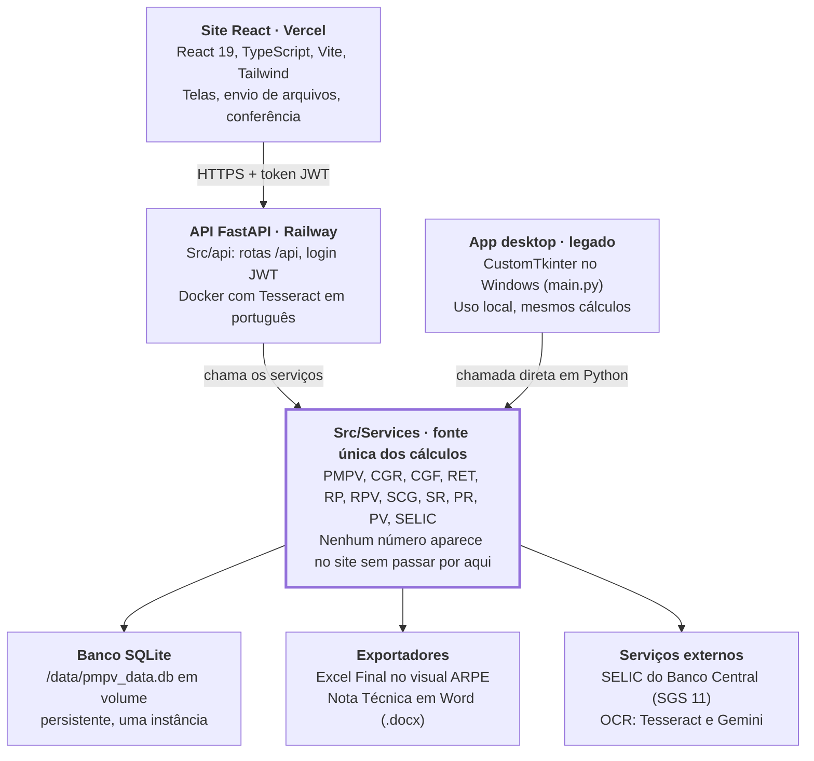
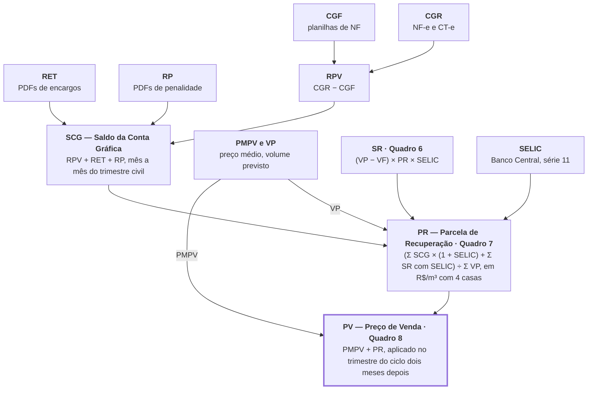

# Plataforma Conta Gráfica ARPE — Documentação Oficial

> Versão de 03/11/2026 · Backend `c3c827d` · Frontend `5f558c2`

A Plataforma Conta Gráfica ARPE calcula, confere e documenta a Conta Gráfica do gás canalizado de Pernambuco, a partir das notas fiscais e planilhas da Copergás. Este documento é a referência oficial do sistema: explica o negócio para quem não é de TI e o código para quem vai mantê-lo.

## Sumário

- [Como usar este documento](#como-usar-este-documento)
- **Parte 1 — Entendendo a Conta Gráfica**
  - [O que é a Conta Gráfica](#o-que-é-a-conta-gráfica)
  - [Glossário](#glossário)
  - [O ciclo de trabalho, passo a passo](#o-ciclo-de-trabalho-passo-a-passo)
- **Parte 2 — Como o sistema é construído**
  - [Arquitetura geral](#arquitetura-geral)
  - [Backend — plataforma-conta-grafica](#backend--plataforma-conta-grafica)
  - [Frontend — PlataformaGrafica-Frontend-](#frontend--plataformagrafica-frontend-)
  - [Fórmulas e regras de cálculo](#fórmulas-e-regras-de-cálculo)
- **Parte 3 — Operação e manutenção**
  - [Instalação, testes e deploy](#instalação-testes-e-deploy)
  - [Manutenção e evolução](#manutenção-e-evolução)

---

## Como usar este documento

O documento tem três partes. Cada leitor pode parar onde a sua necessidade termina.

| Parte | Para quem | O que responde |
| --- | --- | --- |
| 1 — Entendendo a Conta Gráfica | Gestores, analistas da ARPE, auditores, novos colaboradores | O que é a Conta Gráfica, o que cada sigla significa, como é o ciclo de trabalho |
| 2 — Como o sistema é construído | Desenvolvedores, equipe de TI, suporte | Arquitetura, backend, frontend, fórmulas e regras de cálculo |
| 3 — Operação e manutenção | Quem instala, publica e corrige o sistema | Instalação, testes, deploy, fluxo de trabalho no git, solução de problemas |

Os dois repositórios do sistema são:

- **Backend (API e cálculos):** [plataforma-conta-grafica](https://github.com/jleandromorais/plataforma-conta-grafica)
- **Frontend (site):** [PlataformaGrafica-Frontend-](https://github.com/jleandromorais/PlataformaGrafica-Frontend-)

Os números, nomes de arquivos e rotas citados refletem a branch `main` de ambos em 3 de novembro de 2026 (backend `c3c827d`, frontend `5f558c2`).

---

# Parte 1 — Entendendo a Conta Gráfica

## O que é a Conta Gráfica

A Conta Gráfica é uma "conta-corrente" entre a distribuidora de gás e os consumidores: ela registra, mês a mês, quanto o gás realmente custou e quanto foi cobrado na tarifa. A diferença é devolvida ou cobrada nos trimestres seguintes, para que ninguém ganhe nem perca com a variação do preço.

### Por que ela existe

A Copergás, distribuidora de gás canalizado de Pernambuco, compra gás de vários supridores (Petrobras, Brava, Eneva, Galp, GNLink, Orizon, Petrorecôncavo, Mastergás) e paga transporte à TAG. O preço de venda ao consumidor é definido **antes**, com base numa previsão. O custo real só é conhecido **depois**, quando as notas fiscais chegam.

Um exemplo simplificado:

1. A tarifa do trimestre foi fixada prevendo um custo de R$ 2,00 por m³.
2. O gás, na prática, custou R$ 2,10 por m³.
3. A distribuidora pagou R$ 0,10 por m³ a mais do que recebeu. Essa diferença entra na Conta Gráfica como saldo a recuperar.
4. No trimestre seguinte, uma **Parcela de Recuperação (PR)** é somada à tarifa para devolver esse valor, corrigido pela SELIC.
5. Se o custo real tivesse sido menor que o previsto, a PR seria negativa e a tarifa cairia.

### Quem faz o quê

| Ator | Papel |
| --- | --- |
| ARPE (Agência de Regulação de Pernambuco) | Regula a tarifa, apura e fiscaliza a Conta Gráfica, publica a Nota Técnica do repasse |
| Analistas da ARPE | Usuários desta plataforma: conferem notas, fecham os cálculos, geram os documentos |
| Copergás | Distribuidora: envia as notas fiscais, planilhas de faturamento e encargos |
| Supridores e transportadora | Emitem as notas de compra de gás (NF-e) e de transporte (CT-e, notas de débito) |

### O que a plataforma faz

Antes, a apuração era feita copiando valores de notas para planilhas. A plataforma substitui esse trabalho:

- **Lê as notas sozinha:** XML de NF-e/CT-e e PDFs, com reconhecimento de texto (OCR) quando o PDF é uma imagem.
- **Aplica as fórmulas da Nota Técnica** sempre do mesmo jeito, em um único lugar do código.
- **Confere com a planilha oficial** de referência e mostra cada divergência por nota e por supridor, com o valor e o motivo.
- **Guarda tudo num banco único** compartilhado pelos analistas, com histórico.
- **Gera os documentos oficiais:** o Excel Final no visual da ARPE e a minuta da Nota Técnica em Word.

O sistema tem dois princípios inegociáveis: **o número precisa bater, centavo a centavo, com a planilha oficial**, e **todo número precisa ter origem rastreável** (qual nota, qual planilha, qual mês, quem salvou).

## Glossário

As siglas seguem a Nota Técnica (NT) e a Resolução ARPE 304. O mesmo glossário está no código do site (`src/utils/glossario.ts`) e aparece nas dicas das telas.

| Sigla | Nome por extenso | Em linguagem simples | Unidade |
| --- | --- | --- | --- |
| PMPV | Preço Médio Ponderado de Venda | Preço médio do gás no trimestre, pesado pelo volume de cada supridor | R$/m³ |
| VP | Volume Prospectivo | Volume de gás que se prevê vender no trimestre | m³ |
| VF | Volume Faturado | Volume de gás efetivamente faturado aos clientes no mês | m³ |
| CGR | Custo do Gás Realizado | Quanto o gás realmente custou no mês, sem tributos (notas de compra + transporte por gasoduto) | R$ |
| CGF | Custo do Gás Faturado | Quanto do custo do gás foi cobrado na tarifa no mês | R$ |
| RPV | Recuperação de Preço de Venda | Diferença entre o custo real e o cobrado no mês | R$ |
| RET | Recuperação de Encargos de Transporte | Encargos de transporte e de capacidade a recuperar | R$ |
| EAT | Encargo de Transporte | Parte do RET referente ao transporte do gás | R$ |
| EC | Encargo de Capacidade | Parte do RET referente à capacidade contratada | R$ |
| TOP | Take or Pay | Compromisso de compra mínima; entra no RP como receita | R$ |
| RP | Recuperação das Penalidades | Saldo de penalidades pagas e recebidas (art. 14 da Res. 304) | R$ |
| SCG | Saldo da Conta Gráfica | Soma do que há a recuperar no mês: RPV + RET + RP | R$ |
| SR | Saldo Remanescente | O que a PR anterior não conseguiu recuperar porque o volume vendido diferiu do previsto | R$ |
| PR | Parcela de Recuperação | Valor somado à tarifa para recuperar o saldo, por m³ | R$/m³ |
| PV | Preço de Venda | Preço final do gás: PMPV + PR | R$/m³ |
| SELIC | Taxa básica de juros | Corrige os saldos no tempo; buscada no Banco Central (série SGS 11) | % |
| NT | Nota Técnica | Documento oficial da ARPE com os cálculos do repasse (Quadros 1 a 8 e Anexo A) | — |
| NF-e / CT-e | Nota Fiscal / Conhecimento de Transporte eletrônicos | Documentos fiscais de compra de gás e de transporte | — |

> **Ponto em aberto:** o `PRODUCT.md` do frontend define `SCG = RPV + RET + RP + SR anterior`, enquanto o código (`servicos_scg.py`) e o glossário do site usam `SCG = RPV + RET + RP`. Confirmar qual definição é a oficial.

### Dois tipos de trimestre

Este é o ponto que mais gera erro e precisa ficar claro para todos:

| Grade | Trimestres | Usada por |
| --- | --- | --- |
| Trimestre civil | Jan–Mar, Abr–Jun, Jul–Set, Out–Dez | Conta Gráfica: CGR, CGF, RPV, RET, RP, SCG, SR |
| Trimestre do ciclo tarifário | Nov–Jan, Fev–Abr, Mai–Jul, Ago–Out | Tarifa: PMPV, PR, PV |

O trimestre civil apurado define a PR aplicada **dois meses depois**. Exemplo: o saldo de Abr–Jun vira a PR de Ago–Out.

## O ciclo de trabalho, passo a passo

A cada trimestre, o analista sai das pastas de notas fiscais e termina com dois arquivos oficiais: o **Excel Final** e a **minuta da Nota Técnica**. O site guia esse caminho pelo **Painel do Ciclo** (`/ciclo`), que mostra cada etapa como pronta (✅), com atenção (⚠) ou faltando (◌), e o botão **"Fazer agora"** abre a tela certa já no período certo.

### Antes de começar

1. Entre no site com seu e-mail e senha.
2. Reúna a pasta do ciclo (por exemplo, `SCG-26`), com as subpastas de cada mês e de cada supridor.
3. Abra o **Painel do Ciclo** e escolha o trimestre civil (por exemplo, Abr–Jun/2026). O painel pode ler a pasta e mostrar, sem gravar nada, quais arquivos encontrou para cada etapa e mês.

### As etapas

| # | Etapa | O que o analista faz | De onde vem | Frequência |
| --- | --- | --- | --- | --- |
| 1 | PMPV | Informa preços e volumes de cada supridor; o sistema calcula o preço médio e o VP | Planilhas Excel | Trimestre do ciclo |
| 2 | Auditoria CGR | Envia as notas de compra (NF-e) e de transporte (CT-e da TAG); o sistema calcula o custo real e compara com a planilha oficial | XML e PDF | Mensal |
| 3 | CGF | Envia as planilhas de NF faturadas, canceladas e devolvidas; o sistema chega ao volume faturado e ao custo cobrado | Excel / CSV | Mensal |
| 4 | RPV | Confere a diferença entre o custo real (CGR) e o cobrado (CGF) | Etapas 2 e 3 | Mensal |
| 5 | RET | Envia os PDFs de encargos de transporte; o sistema separa EAT e EC | PDFs (com OCR) | Mensal |
| 6 | RP | Envia as notas de penalidade; o sistema separa receitas (inclui TOP) e despesas | PDFs (com OCR) | Mensal |
| 7 | SCG | Junta RPV, RET e RP de cada mês, escolhe o valor certo onde houver divergência e salva | Etapas 4 a 6 | Mensal |
| 8 | SR | Calcula, mês a mês, o que a PR anterior deixou de recuperar, com SELIC do Banco Central (Quadro 6) | PMPV, CGF, PR salvo | Trimestre civil |
| 9 | PR | Converte o saldo a recuperar em R$/m³ para o trimestre do ciclo seguinte (Quadro 7) | SCG, SR, VP | Trimestre do ciclo |
| 10 | PV | Soma PMPV + PR para chegar ao preço de venda (Quadro 8) | PMPV, PR | Trimestre do ciclo |
| 11 | Excel Final e Nota Técnica | Gera a planilha consolidada no visual da ARPE e a minuta em Word | Banco de dados | Fim do ciclo |

### Regras de ouro

- **Nada é gravado sem confirmação.** As telas leem os arquivos, mostram o resultado e só salvam quando o analista clica em salvar.
- **Divergência não é escondida.** Quando o valor calculado difere do gravado ou da planilha oficial, a tela mostra qual nota, qual supridor, quanto e por quê.
- **A ordem importa.** O PR depende do SCG e do SR; o SR depende do PR salvo do trimestre anterior. Pular etapas gera aviso no Painel do Ciclo.
- **Partes manuais da Nota Técnica** saem destacadas em amarelo na minuta, para o analista completar.

---

# Parte 2 — Como o sistema é construído

## Arquitetura geral

O sistema é dividido em dois repositórios: um **backend em Python** que concentra todos os cálculos e um **frontend em React** que só exibe, envia arquivos e pede confirmação. A regra central da arquitetura é que `Src/Services` é a fonte única de verdade: o site, a API e o app desktop legado chamam os mesmos serviços, nunca reimplementam uma fórmula.



O backend segue Clean Architecture: interface (API ou telas desktop) → serviços de negócio → infraestrutura (banco, exportadores, OCR).

### Tecnologias

| Camada | Tecnologia | Onde roda |
| --- | --- | --- |
| Frontend | React 19, TypeScript 6, Vite 8, Tailwind 4, React Router 7, Recharts, Axios | Vercel (publica a `main`) |
| API | Python 3.10+, FastAPI, Uvicorn, PyJWT (HS256), senhas com scrypt | Railway, imagem Docker |
| Cálculos | Python: pandas, openpyxl, pdfplumber | Dentro da API e do desktop |
| OCR de PDF | Tesseract em português (padrão) e Google Gemini (alternativo) | Imagem Docker |
| Banco | SQLite (`pmpv_data.db`) | Volume persistente `/data` |
| Documentos | openpyxl (Excel Final), python-docx (Nota Técnica) | Gerados sob demanda pela API |
| Desktop legado | CustomTkinter, PyInstaller | Windows, local |

### Caminho de uma requisição

1. O analista faz login; a API devolve um token JWT, guardado no navegador.
2. Cada chamada do site leva o token no cabeçalho `Authorization: Bearer`.
3. A API valida o token. Todas as rotas exigem login, exceto `/api/auth/*` e `/api/health`.
4. O router recebe o pedido (e os arquivos enviados), valida o formato com schemas Pydantic e chama a função de `Src/Services`.
5. O serviço calcula e, quando o analista confirma, grava no SQLite.
6. A resposta volta em JSON; erros voltam em português, dizendo o que fazer.

A antiga stack Apache Airflow + PostgreSQL foi descontinuada em junho de 2026 e arquivada em `_arquivado/backend/`, porque duplicava e divergia dos cálculos oficiais. Não deve ser usada.

## Backend — plataforma-conta-grafica

O backend é um projeto Python que expõe os cálculos por uma API FastAPI e mantém o app desktop legado. Tudo o que importa para o negócio está em `Src/Services`; o resto é entrada (API, telas) ou saída (banco, Excel, Word).

### Estrutura de pastas

| Pasta / arquivo | Responsabilidade |
| --- | --- |
| `Src/api/` | API FastAPI: `main.py` (app e rotas), `routers/` (um por módulo), `schemas/` (contratos Pydantic), `auth.py` (login JWT), `errors.py` (mensagens em português), `serve.py` (entrada em produção), `uploads.py` |
| `Src/Services/` | Regras de negócio e fórmulas. Fonte única dos cálculos |
| `Src/Database/database.py` | Classe `DatabasePMPV`: cria e acessa as tabelas SQLite |
| `Src/infrastructure/` | Exportadores (Excel Final, Nota Técnica), OCR (Tesseract, Gemini), repositórios SQLite |
| `Src/application/`, `Src/domain/` | Casos de uso e interfaces (ports) da Clean Architecture |
| `Src/common/` | Utilitários: normalização de períodos, formatação em R$, regras de precisão, caminhos |
| `Src/Views/`, `main.py` | App desktop em CustomTkinter (legado) |
| `tests/` | Testes automatizados com pytest |
| `Dockerfile`, `requirements-api.txt`, `DEPLOY.md` | Imagem e dependências da API em produção |
| `_arquivado/backend/` | Stack Airflow + PostgreSQL descontinuada (só referência histórica) |

### Serviços de cálculo (`Src/Services`)

| Arquivo | O que faz |
| --- | --- |
| `servicos_pmpv.py` | PMPV e VP do trimestre |
| `servicos_auditoria.py`, `servicos_auditoria_lote.py` | Lê NF-e/CT-e (XML e PDF) e calcula o CGR por empresa e por mês |
| `diferencas_auditoria.py`, `explicador_diferencas.py` | Aponta onde o CGR processado difere do gravado ou da planilha, por empresa e por nota, e explica o motivo |
| `comparador_modelo_nt.py`, `comparador_modelo_apuracao.py`, `comparador_modelo_alexandre.py`, `comparador_conta_grafica.py`, `comparacao_registro.py` | Compara os resultados com a NT, com a planilha de Apuração de Custos e com a planilha oficial de referência |
| `supridores.py` | Cadastro e identificação dos supridores |
| `servicos_cgf.py` | Volume faturado (faturadas − canceladas − devoluções − consumo próprio) e CGF em R$ |
| `servicos_rpv.py` | RPV = CGR − CGF |
| `servicos_ret.py`, `servicos_ret_lote.py`, `excel_ret.py` | Lê PDFs de encargos e classifica em EAT, EC, TOP e penalidades |
| `servicos_concilia.py`, `servicos_concilia_lote.py`, `excel_concilia.py` | RP: receitas e despesas de penalidade |
| `servicos_scg.py`, `servicos_consolidacao.py` | SCG = RPV + RET + RP e consolidação mensal |
| `servicos_sr.py` | SR do trimestre civil, mês a mês (Quadro 6) |
| `servicos_selic.py` | Busca a SELIC no Banco Central (série SGS 11, fator diário) e acumula por período |
| `servicos_pr.py`, `servicos_pv.py` | PR (Quadro 7) e PV (Quadro 8) |

### API — grupos de rotas

Todas as rotas ficam sob `/api` e exigem login, exceto `/api/auth/*` e `/api/health`. A documentação interativa (Swagger) fica em `/docs` com a API rodando.

| Grupo | Rotas principais | Função |
| --- | --- | --- |
| `auth` | `POST /login`, `POST /cadastro`, `GET /me` | Contas e sessão |
| `pmpv` | `POST /calcular`, `/salvar`, `/importar-memoria`, `GET /historico`, `/trimestre-ativo` | PMPV e VP |
| `auditoria` | `POST /processar`, `/salvar`, `/diferencas`, `/relatorio`, `GET /historico` | CGR a partir das notas |
| `cgf` | `POST /processar`, `/calcular-rs`, `/salvar`, `GET /historico` | Volume e custo faturados |
| `ret` | `POST /processar`, `/salvar`, `GET /historico` | Encargos de transporte |
| `conciliacao` | `POST /processar`, `/salvar`, `/relatorio`, `GET /historico` | RP |
| `rpv` | `GET`, `POST /salvar`, `GET /historico` | RPV mensal |
| `scg` | `GET`, `/comparar`, `POST /calcular`, `/salvar`, `/manual`, `DELETE` | SCG mensal |
| `sr` | `POST /trimestre/carregar`, `/trimestre/calcular`, `/trimestre/salvar`, `GET /selic` | Quadro 6 e SELIC |
| `pr`, `pv` | `POST /apurar`, `/salvar`, `GET /trimestre` | Quadros 7 e 8 |
| `excel_final`, `nota_tecnica` | `POST /excel-final/gerar`, `/gerar-geral`, `GET /cobertura`, `POST /nota-tecnica/gerar` | Documentos do ciclo |
| `dashboard`, `config` | `GET /dashboard`, `/empresas`, `/ret`, `/volumes`; `GET /config/taxas`, `/trimestres-civis`, `/trimestres-fiscais` | Painéis e parâmetros |

O padrão das telas que leem arquivos é sempre o mesmo: `processar` calcula sem gravar, o analista confere, `salvar` grava, `historico` lista o que já foi gravado.

### Banco de dados

SQLite em um arquivo só (`pmpv_data.db`). Em produção fica no volume persistente `/data`; o caminho pode ser trocado pela variável `PLATAFORMA_DB`.

| Tabela | Conteúdo |
| --- | --- |
| `sessoes`, `dados_mes`, `resultados` | Sessões de PMPV, dados mensais por empresa e resultados |
| `pmpv_mensal`, `vp_mensal` | PMPV e VP por período |
| `auditoria_itens` | Itens de NF-e/CT-e (valor, ICMS, PIS, COFINS, CGR) |
| `cgf_resumo` | Volumes faturados por período |
| `ret_itens` | Encargos de transporte por tipo e empresa |
| `concilia_itens` | Receitas e despesas do RP |
| `consolidacao` | CGR, CGF, RPV, RET, RP e SCG por mês |
| `sr_resultados`, `sr_trimestre` | SR por período e Quadro 6 mês a mês |
| `pr_resultados`, `pv_resultados` | Quadros 7 e 8 |
| `excel_final_sessoes`, `excel_final_execucoes` | Histórico de geração do Excel Final |
| `config` | Configurações gerais |
| `usuarios`, `auth_config` | Contas do site e segredo do token (só a API) |

Períodos são normalizados automaticamente para o formato `Mmm/AAAA`: `Dez/25`, `DEZ/25` e `12/25` viram `Dez/2025`.

### Precisão numérica

Para bater centavo a centavo com a planilha oficial, o backend arredonda em pontos fixos (`Src/common/precisao.py`):

- **Tarifas (PMPV, PR):** 4 casas decimais antes de multiplicar.
- **Volume final:** 2 casas antes de multiplicar pelo PMPV. Sem esse arredondamento, Jun, Ago e Set de 2026 saíam 1 centavo fora.
- Exemplo real: CGF de Mai/2026 = 45.564.265,79 m³ × 2,2830 = R$ 104.023.218,80.

### Segurança e erros

- Senhas guardadas com scrypt; sessão por token JWT HS256 com validade padrão de 12 horas (`JWT_EXPIRA_HORAS`).
- `PERMITIR_CADASTRO=0` fecha o autocadastro depois que as contas forem criadas.
- `CORS_ORIGINS` limita quais sites podem chamar a API.
- Erros: `ValueError` vira HTTP 422, banco travado vira 503, erro inesperado vira 500 com um `codigo` que aparece no log. Nenhuma resposta expõe caminho de arquivo ou traceback.

## Frontend — PlataformaGrafica-Frontend-

O frontend é uma aplicação React de página única que não calcula nada: ela envia arquivos, mostra o que a API calculou e pede confirmação antes de gravar. Publicada na Vercel, em https://plataforma-grafica-frontend.vercel.app.

### Estrutura de pastas

| Pasta | Responsabilidade |
| --- | --- |
| `src/api/` | `client.ts` (Axios, URL da API, mensagens de erro em pt-BR), `index.ts` (uma função por rota da API), `auth.ts` |
| `src/auth/` | `AuthContext` (sessão e token) e `RequireAuth` (bloqueia telas sem login) |
| `src/components/layout/` | `Layout`, `Sidebar`, `PageHeader` e `modulos.ts` (cadastro central das telas, do menu e da ordem do ciclo) |
| `src/components/ui/` | Componentes reutilizáveis: `Alert`, `Button`, `Card`, `Table`, `Input`, `SeletorMes`, `SeletorArquivos`, `SeletorPasta`, `Valor`, `Conferencia`, `ListaProblemas`, `AvisoPdfNaoLido` |
| `src/pages/` | Uma pasta por tela |
| `src/router/` | Rotas (React Router) |
| `src/types/` | Tipos TypeScript das respostas da API |
| `src/utils/` | `glossario.ts`, `periodos.ts`, `periodoNaUrl.ts`, `pastaCiclo.ts`, `format.ts`, `tema.ts`, `cgfColunas.ts`, `download.ts` |
| `public/` | Logos e favicon da ARPE |

### Telas

| Grupo do menu | Tela | Rota | O que faz |
| --- | --- | --- | --- |
| Início | Painel do Ciclo | `/ciclo` | As etapas do trimestre com status e motivo de cada pendência; "Fazer agora"; leitura da pasta do ciclo; processamento em lote (Auditoria, CGF e RET) |
| Início | Dashboard | `/` | Evolução histórica: PMPV, SCG, CGR × CGF, CGR por empresa, RET por tipo, volumes |
| Início | PMPV | `/pmpv` | Preço médio de venda e VP do trimestre |
| Conta Gráfica | Auditoria CGR | `/auditoria` | NF-e e CT-e de compra; comparação com a NT ou com a planilha |
| Conta Gráfica | CGF | `/cgf` | Planilhas de NF faturadas, canceladas e devolvidas |
| Conta Gráfica | RPV | `/rpv` | CGR − CGF do mês |
| Conta Gráfica | RET | `/ret` | PDFs de encargos (EAT + EC) |
| Conta Gráfica | RP | `/conciliacao` | Receitas (inclui TOP) e despesas de penalidade |
| Conta Gráfica | SCG | `/scg` | RPV + RET + RP; valor gravado × módulos |
| Conta Gráfica | SR | `/sr` | Quadro 6 com SELIC preenchida pelo Banco Central |
| Consolidação | PR | `/pr` | Quadro 7 |
| Consolidação | PV | `/pv` | Quadro 8 |
| Exportação | Excel Final | `/excel-final` | Excel consolidado e minuta da Nota Técnica |
| — | Login, Cadastro | `/login`, `/cadastro` | Acesso; só visíveis sem sessão |

### Convenções importantes

- **Cadastro central das telas.** `src/components/layout/modulos.ts` define nome, ícone, rota e propósito de cada tela, os grupos do menu e a ordem de trabalho do ciclo (`ORDEM_DO_CICLO`), usada pelos botões "Anterior / Próxima". Uma tela nova entra primeiro aqui.
- **Glossário único.** `src/utils/glossario.ts` guarda nome por extenso e fórmula de cada sigla; menu, títulos e dicas leem dali.
- **Período no endereço.** As telas aceitam `?periodo=Mai/2026` (mensais) ou `?trimestre=Abr/2026` (primeiro mês do trimestre). Com `?de=ciclo&ciclo=Abr/2026` mostram "Voltar ao Painel do Ciclo". Contrato em `src/utils/periodoNaUrl.ts`.
- **Trimestre civil → trimestre do PR.** `mesesDoPRDoCivil` em `src/utils/periodos.ts` desloca o trimestre civil em 2 meses.
- **Leitura da pasta do ciclo.** `src/utils/pastaCiclo.ts` reconhece, só pelo caminho do arquivo, a etapa e o mês (ex.: `RPV/CGR/01 jan-26 Notas Fiscais`). Nunca adivinha calado: o que não tem certeza vira aviso.
- **Mensagens de erro.** `mensagemDeErro()` em `src/api/client.ts` gera "ação: motivo" em português; o detalhe técnico (método, rota, HTTP) fica recolhido em "Detalhes técnicos" no `Alert`, para mandar ao suporte.
- **Tema.** Escuro é o padrão desde 03/11/2026; o claro ARPE fica como opção no menu (`src/utils/tema.ts`).
- **Tempo limite.** Chamadas à API expiram em 30 segundos.

### Princípios de interface

Vindos de `PRODUCT.md`, valem para qualquer tela nova:

1. **O número certo vem antes de tudo.** Nenhum valor aparece sem vir da API; divergência fica visível.
2. **Todo número tem origem.** O analista desce do total até a nota, a linha da planilha e o mês.
3. **Densidade legível.** Alinhamento e leitura rápida valem mais que efeito visual; nada com "cara de IA".
4. **Dizer o que fazer.** Erros e avisos explicam motivo e próximo passo em português simples.
5. **Sigilo por padrão.** Nenhum dado da distribuidora fica acessível sem login.

## Fórmulas e regras de cálculo

Todas as fórmulas abaixo são as da Nota Técnica da ARPE e estão implementadas apenas em `Src/Services`. PIS e COFINS somam 9,25% (PIS 1,65% + COFINS 7,6%); tarifas usam 4 casas decimais e volumes 2 casas.



O desenho mostra a dependência: o PR só pode ser apurado depois que o SCG dos três meses e o SR do trimestre estiverem salvos.

### PMPV — Preço Médio Ponderado de Venda

Média dos preços dos supridores, pesada pelo volume de cada um.

```math
PMPV = \frac{\sum_i P_i \cdot V_i}{\sum_i V_i}
```

### CGR — Custo do Gás Realizado

Compra de gás sem tributos, das NF-e dos supridores e dos CT-e de gasoduto, com devoluções abatidas.

```math
CGR = \left(\sum \text{valor} - \sum \text{ICMS}\right) \times (1 - \text{PIS} - \text{COFINS})
```

### CGF — Custo do Gás Faturado

Primeiro o volume faturado líquido do mês; depois o custo, com volume arredondado a 2 casas e PMPV a 4 casas.

```math
VF = \text{faturado} - \text{cancelado} - \text{devoluções} - \text{consumo próprio}
```

```math
CGF = \mathrm{round}(VF, 2) \times \mathrm{round}(PMPV, 4)
```

### RPV, RET, RP e SCG — apuração mensal

```math
RPV = CGR - CGF
```

```math
RET = \sum EAT \times (1 - 0{,}0925) + \sum EC
```

```math
RP = \left(\sum \text{despesas} - \sum \text{receitas}\right) \times (1 - 0{,}0925)
```

```math
SCG = RPV + RET + RP
```

No RP, o Take or Pay (TOP) entra como receita.

### SELIC acumulada

Buscada na série SGS 11 do Banco Central (fator diário), com 6 casas. A série 4390 não é usada porque tem só 2 casas e diverge das planilhas (Jul/25: 1,28% contra 1,275733%).

```math
\text{SELIC do mês} = \prod_{\text{dias úteis}} \left(1 + \frac{\text{taxa do dia}}{100}\right)
```

```math
\text{acumulada do mês} = \prod_{\text{mês} \to \text{fim do trimestre}} (1 + \text{SELIC do mês}) - 1
```

Trimestre ainda aberto não recebe SELIC parcial. Se o Banco Central não responder, a tela do SR pede para digitar à mão.

### SR — Saldo Remanescente (Quadro 6)

O que a PR em vigor deixou de recuperar porque o volume vendido (VF) diferiu do previsto (VP), mês a mês do trimestre civil.

```math
SR = (VP - VF) \times PR \times (1 + \text{SELIC acumulada})
```

### PR — Parcela de Recuperação (Quadro 7)

O SCG e o SR do trimestre civil apurado, corrigidos pela SELIC, divididos pelo VP dos três meses do trimestre do PR. O trimestre do PR começa dois meses depois do fim do trimestre civil apurado.

```math
PR = \mathrm{round}\left(\frac{\sum SCG \times (1 + \text{SELIC}) + \sum SR_{\text{com SELIC}}}{\sum VP},\ 4\right)
```

### PV — Preço de Venda (Quadro 8)

```math
PV = PMPV + PR
```

---

# Parte 3 — Operação e manutenção

## Instalação, testes e deploy

Para rodar o sistema localmente, suba primeiro a API e depois o site apontando para ela. Em produção, um push na `main` de cada repositório publica sozinho: backend no Railway, frontend na Vercel.

### Pré-requisitos

| Ferramenta | Versão | Para quê |
| --- | --- | --- |
| Windows | 10 ou 11 | Ambiente de trabalho atual |
| Python | 3.10+ | Backend |
| Node.js | 22+ | Frontend |
| Git | qualquer recente | Clonar e versionar |
| Tesseract OCR (português) | — | Ler PDFs escaneados localmente (já vem na imagem Docker) |

### Backend local

```powershell
git clone https://github.com/jleandromorais/plataforma-conta-grafica.git
cd plataforma-conta-grafica
python -m venv .venv
.\.venv\Scripts\Activate.ps1
pip install -r requirements-api.txt

# use uma CÓPIA do banco, nunca o original
$env:PLATAFORMA_DB = "C:\caminho\para\copia\pmpv_data.db"
python -m uvicorn Src.api.main:app --reload --port 8080
```

Confira em http://localhost:8080/api/health (deve responder `{"status":"ok"}`) e veja as rotas em http://localhost:8080/docs. Para o app desktop legado, instale `requirements.txt` e rode `python main.py`.

### Frontend local

```powershell
git clone https://github.com/jleandromorais/PlataformaGrafica-Frontend-.git
cd PlataformaGrafica-Frontend-
npm install
copy .env.example .env      # VITE_API_URL=http://localhost:8080/api
npm run dev                 # http://localhost:5173
```

O atalho `iniciar_web.bat`, na pasta acima dos dois repositórios, sobe API e site juntos com uma cópia do banco.

### Testes

| Repositório | Comando | O que cobre |
| --- | --- | --- |
| Backend | `python -m pytest` | Cerca de 600 testes: fórmulas de cada módulo, SELIC igual às planilhas ARPE, Quadros 7 e 8, Excel Final, Nota Técnica, erros da API, banco com várias threads |
| Backend | `python -m pytest --cov=Src --cov-report=html` | O mesmo, com relatório de cobertura |
| Frontend | `npm test` | Vitest: leitura da pasta do ciclo e conversão de períodos |
| Frontend | `npm run build` e `npm run lint` | Checagem de tipos e ESLint |

Testes que dependem de pastas reais de notas (`SCG-26 - Copia`) são pulados quando a pasta não existe.

### Deploy em produção

**Backend (Railway, imagem Docker):**

1. O serviço usa o `Dockerfile` da raiz, que roda `python -m Src.api.serve` e já instala o Tesseract em português.
2. Um volume persistente montado em `/data` guarda o banco (`/data/pmpv_data.db`). Sem ele, o banco some a cada deploy.
3. Antes de juntar na `main`, faça backup do volume (Railway → Volumes → Backups).
4. Push na `main` publica a nova versão; o deploy troca o programa, não o banco.

| Variável | Valor | Obrigatória |
| --- | --- | --- |
| `JWT_SECRET` | Texto longo e aleatório (ex.: `openssl rand -hex 32`) | Sim |
| `CORS_ORIGINS` | URL do site na Vercel (várias separadas por vírgula) | Sim |
| `PERMITIR_CADASTRO` | `0` fecha o autocadastro | Recomendada |
| `JWT_EXPIRA_HORAS` | Validade do login (padrão 12) | Não |
| `PLATAFORMA_DB` | Já vem `/data/pmpv_data.db` na imagem | Não |

**Frontend (Vercel):** publica a `main` sozinha. A única variável é `VITE_API_URL` = URL da API no Railway + `/api`.

**Ordem quando os dois mudam juntos:** publique o backend primeiro, depois o frontend.

### Restrições de operação

- **Uma instância só da API.** O SQLite não suporta vários servidores gravando ao mesmo tempo.
- **O banco não vai pelo git** (`*.db` é ignorado). Para levar dados existentes, copie o arquivo para `/data/pmpv_data.db` antes do primeiro uso.
- **Dados sigilosos.** Valores e notas da Copergás são restritos; tudo fica atrás de login.

## Manutenção e evolução

Toda mudança nasce numa branch, passa pelos testes e entra na `main` por Pull Request; como a `main` publica sozinha, ela deve estar sempre pronta para produção.

### Fluxo de trabalho no git

1. Atualize a `main`: `git checkout main` e `git pull`.
2. Crie uma branch: `git checkout -b feat/descricao-curta` (ou `fix/...`, `docs/...`, `test/...`).
3. Faça a mudança junto com os testes.
4. Rode os testes: `python -m pytest` no backend; `npm run build`, `npm test` e `npm run lint` no frontend.
5. Commits semânticos em português, por exemplo `feat(sr): ...`, `fix(cgf): ...`, `docs(readme): ...`.
6. Abra o Pull Request no GitHub com o contexto funcional e técnico.
7. Antes de juntar no backend, faça backup do volume no Railway.
8. Junte na `main`. Se os dois repositórios mudaram, junte o backend primeiro.

As especificações (BMAD) de cada história ficam anexadas ao cartão correspondente no Trello do projeto.

### Como adicionar ou mudar um cálculo

1. Altere apenas o serviço em `Src/Services`. Nunca replique a fórmula na API, no site ou no desktop.
2. Use as funções de `Src/common/precisao.py` para arredondar tarifas e volumes.
3. Escreva um teste com um caso real da planilha oficial, comparando centavo a centavo.
4. Se a saída mudou, ajuste o schema em `Src/api/schemas` e o tipo em `src/types` no frontend.
5. Se a sigla ou a fórmula exibida mudou, ajuste `src/utils/glossario.ts` e esta documentação.

### Como adicionar uma tela

1. Crie a rota no backend (`Src/api/routers`) e registre em `Src/api/main.py` com login obrigatório.
2. No frontend, adicione a função em `src/api/index.ts`, a página em `src/pages/<Tela>/index.tsx` e a rota em `src/router/index.tsx`.
3. Cadastre a tela em `src/components/layout/modulos.ts` (menu, propósito, ordem do ciclo).
4. Siga o padrão processar → conferir → salvar e os princípios de interface da Parte 2.

### Solução de problemas

| Sintoma | Causa provável | O que fazer |
| --- | --- | --- |
| Site mostra "sem conexão com o servidor" | API fora do ar ou URL errada | Abra `/api/health`; confira `VITE_API_URL` na Vercel e `CORS_ORIGINS` no Railway; veja a rota em "Detalhes técnicos" da mensagem |
| Erro com um `codigo` na mensagem | Erro inesperado (HTTP 500) | Procure o código no log da API no Railway |
| Falha só com várias telas abertas | Conexão SQLite compartilhada entre threads | Confirme que a versão tem a correção `a1e7976` |
| SELIC não veio sozinha no SR | Trimestre ainda aberto ou Banco Central fora do ar | Aguarde o fim do trimestre, clique em "Tentar de novo" ou digite à mão |
| PDF voltou sem valores | PDF escaneado sem OCR | Confirme que o Tesseract em português está instalado; a tela avisa quais PDFs não foram lidos |
| CGF com 1 centavo de diferença | Arredondamento | Confira se o volume entrou com 2 casas e o PMPV com 4 (`precisao.py`) |
| CGF com aviso "Devoluções = 0" | Planilha de devoluções não enviada | Reenvie as planilhas do mês incluindo a de devoluções |
| PR não calcula | Falta SCG de algum mês, SR do trimestre ou VP | O Painel do Ciclo e a tela PR listam a pendência exata |
| Valores parecem do trimestre errado | Mistura de trimestre civil e do ciclo | Revise a seção "Dois tipos de trimestre" |
| Excel Final não atualiza (desktop) | Arquivo aberto no Excel | Feche o arquivo e gere de novo |
| Banco vazio depois do deploy | Volume `/data` não montado | Monte o volume e restaure o backup |

### Documentos de referência

- `README.md` de cada repositório: visão resumida e comandos.
- `DEPLOY.md` (backend): detalhes da publicação.
- `PRODUCT.md` (frontend): usuários, propósito e princípios do produto.
- `SPEC_BACKEND_FASTAPI.md`, `ARCHITECTURE.md`, `MODULOS.md` (backend): especificação e arquitetura.
- Planilha oficial de referência: `Novo modelo Alexandre Conta gráfica - Calculador - rev9 - com cálculo da PR e PMPV.xlsx`.

Ao mudar uma fórmula, uma rota ou o fluxo do ciclo, atualize também este documento.
