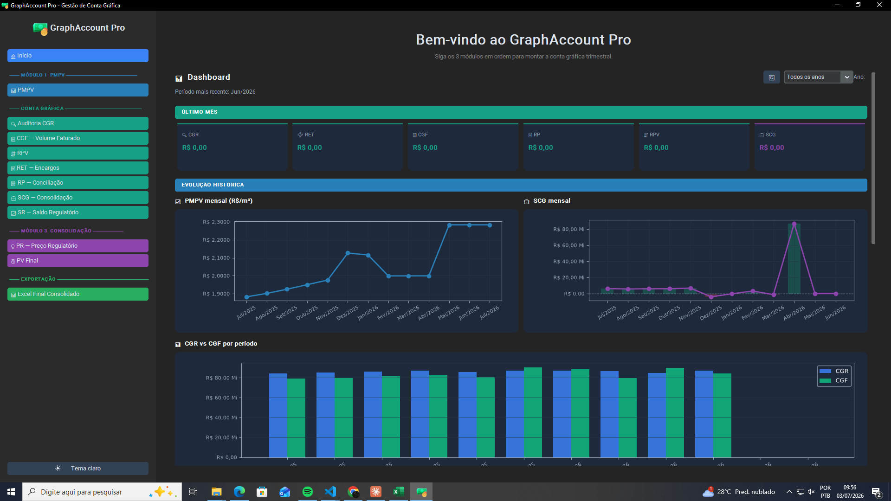
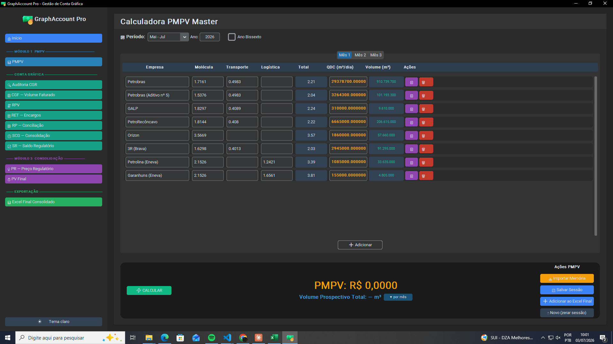
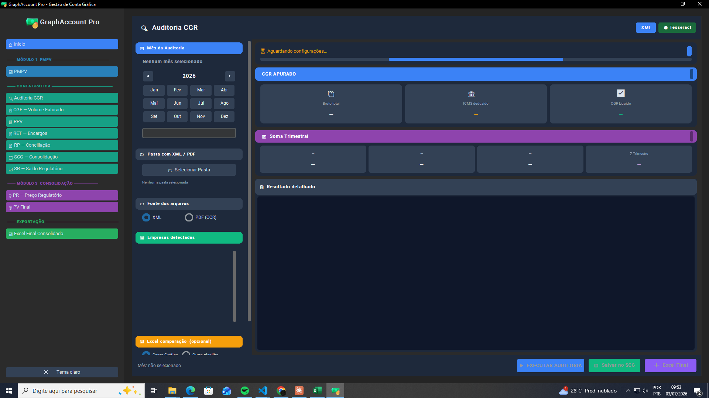

<div align="center">
  

  <h1>Plataforma Conta Gráfica</h1>

  <p>
    <strong>Sistema integrado de gestão financeira para apuração de Conta Gráfica<br/>no mercado regulado de gás canalizado</strong>
  </p>

  <p><em>Desenvolvido para a ARPE — Agência de Regulação de Pernambuco</em></p>

  <br/>

  <p>
    
    
    
    
    
    
    
  </p>

  <br/>

  <p>
    <a href="#-visão-geral">Visão Geral</a> &nbsp;•&nbsp;
    <a href="#️-screenshots">Screenshots</a> &nbsp;•&nbsp;
    <a href="#-módulos">Módulos</a> &nbsp;•&nbsp;
    <a href="#-arquitetura">Arquitetura</a> &nbsp;•&nbsp;
    <a href="#-api-web">API web</a> &nbsp;•&nbsp;
    <a href="#-instalação">Instalação</a> &nbsp;•&nbsp;
    <a href="#-backend">Backend</a> &nbsp;•&nbsp;
    <a href="#-testes">Testes</a> &nbsp;•&nbsp;
    <a href="#-troubleshooting">Troubleshooting</a>
  </p>
</div>

---

## 📋 Visão Geral

Sistema para apuração completa de Conta Gráfica do mercado regulado de gás: calcula e consolida PMPV, CGR, CGF, RET, RP, RPV, SCG, SR, PR e PV, gera o **Excel Final** no visual da ARPE e a **minuta da Nota Técnica** (Word, Quadros 1–8 e Anexo A).

O mesmo código roda de duas formas:

| | Como roda | Para quem |
|---|---|---|
| 🌐 **Web** | **API FastAPI** (`Src/api`) no **Railway** + site React ([PlataformaGrafica-Frontend-](https://github.com/jleandromorais/PlataformaGrafica-Frontend-)) na **Vercel**, com login | uso diário, sem instalar nada |
| 🖥️ **Desktop** | app Windows em CustomTkinter (`main.py`, `Src/Views`) | uso local / legado |

`Src/Services/*` é a **fonte única de verdade dos cálculos**: a API e o desktop chamam os mesmos serviços. A antiga stack Apache Airflow + PostgreSQL foi **descontinuada e arquivada** em `_arquivado/backend/` por duplicar — e divergir de — esses cálculos; ver seção [Backend antigo](#-backend).

<br/>

<div align="center">

| 📁 Arquivos Python (Src) | 🌐 Grupos de rotas da API | 🖥️ Telas desktop | ⚙️ Serviços | 🗄️ Tabelas | 🧪 Arquivos de teste |
|:-:|:-:|:-:|:-:|:-:|:-:|
| **104** | **15** | **10** | **25** | **18** | **51** |

</div>

---

## 🖼️ Screenshots

<div align="center">

<table>
  <tr>
    <td align="center" width="50%">
      
      <br/><sub><strong>Dashboard</strong> — visão consolidada e evolução histórica (PMPV, SCG, CGR vs CGF)</sub>
    </td>
    <td align="center" width="50%">
      
      <br/><sub><strong>Módulo PMPV</strong> — calculadora de Preço Médio Ponderado por Volume</sub>
    </td>
  </tr>
  <tr>
    <td align="center" width="50%" colspan="2">
      
      <br/><sub><strong>Auditoria CGR</strong> — apuração via XML/PDF com soma trimestral</sub>
    </td>
  </tr>
</table>

</div>

---

## 🧩 Módulos

As etapas operam em sequência até as entregas do ciclo (Excel Final e minuta da Nota Técnica). As fórmulas são as da Nota Técnica da ARPE:

<br/>

<table>
  <thead>
    <tr>
      <th align="center">#</th>
      <th>Módulo</th>
      <th>Fórmula / Lógica</th>
      <th>Entrada</th>
      <th>Saída</th>
    </tr>
  </thead>
  <tbody>
    <tr>
      <td align="center"><strong>1</strong></td>
      <td>📊 <strong>PMPV</strong></td>
      <td>Preço Médio Ponderado por Volume (trimestral)</td>
      <td>Planilhas Excel</td>
      <td>PMPV em R$/m³ por período</td>
    </tr>
    <tr>
      <td align="center"><strong>2</strong></td>
      <td>🔀 <strong>Conciliação RP</strong></td>
      <td>Consolidação receitas × despesas</td>
      <td>PDFs (com OCR)</td>
      <td>Itens conciliados</td>
    </tr>
    <tr>
      <td align="center"><strong>3</strong></td>
      <td>🚚 <strong>RET</strong></td>
      <td>Recuperação de Encargos de Transporte</td>
      <td>Pasta de PDFs</td>
      <td>Classificação EAT / EC / TOP / Penalidades</td>
    </tr>
    <tr>
      <td align="center"><strong>4</strong></td>
      <td>🔍 <strong>Auditoria XML</strong></td>
      <td><code>CGR = (Σ valor − Σ ICMS) × (1 − PIS − COFINS)</code></td>
      <td>XML NF-e / CT-e</td>
      <td>CGR líquido por empresa</td>
    </tr>
    <tr>
      <td align="center"><strong>5</strong></td>
      <td>📦 <strong>CGF</strong></td>
      <td>Volume Faturado − Cancelados − Devoluções − Consumo próprio</td>
      <td>Excel / CSV</td>
      <td>Volume final faturado</td>
    </tr>
    <tr>
      <td align="center"><strong>6</strong></td>
      <td>⚖️ <strong>RPV</strong></td>
      <td><code>RPV = CGR − CGF</code></td>
      <td>Banco de dados</td>
      <td>Saldo RPV</td>
    </tr>
    <tr>
      <td align="center"><strong>7</strong></td>
      <td>💹 <strong>SR</strong></td>
      <td><code>SR = (VP − VF) × PR × (1 + SELIC acumulada)</code><br/><sub>por mês do trimestre civil; SELIC buscada no Banco Central (Quadro 6)</sub></td>
      <td>VP do PMPV, VF do CGF, PR salvo</td>
      <td>Saldo Remanescente</td>
    </tr>
    <tr>
      <td align="center"><strong>8</strong></td>
      <td>📈 <strong>SCG</strong></td>
      <td><code>SCG = RPV + RET + RP</code></td>
      <td>Todos os módulos</td>
      <td>Saldo Conta Gráfica</td>
    </tr>
    <tr>
      <td align="center"><strong>9</strong></td>
      <td>💰 <strong>PR</strong></td>
      <td><code>PR = ROUND((Σ SCG × (1 + SELIC) + Σ SR com SELIC) ÷ VP; 4)</code><br/><sub>trimestre civil apurado → trimestre do PR 2 meses depois (Quadro 7)</sub></td>
      <td>SCG, SR e VP do PMPV</td>
      <td>Parcela de Recuperação (R$/m³)</td>
    </tr>
    <tr>
      <td align="center"><strong>10</strong></td>
      <td>🧾 <strong>PV</strong></td>
      <td><code>PV = PMPV + PR</code></td>
      <td>PMPV e PR</td>
      <td>Preço de venda final (R$/m³)</td>
    </tr>
    <tr>
      <td align="center"><strong>11</strong></td>
      <td>📤 <strong>Excel Final</strong></td>
      <td>Consolidação de todas as etapas</td>
      <td>Banco de dados</td>
      <td>Arquivo <code>.xlsx</code> no visual da ARPE (SCG, SR, PR, PV, Auditoria, CGF, RET, Conciliação, PMPV, Progresso)</td>
    </tr>
    <tr>
      <td align="center"><strong>12</strong></td>
      <td>📝 <strong>Nota Técnica</strong></td>
      <td>Minuta com capa, seções 1–5, Quadros 1–8 e Anexo A; partes manuais em amarelo</td>
      <td>Resultados do ciclo</td>
      <td>Arquivo <code>.docx</code> (<code>POST /api/nota-tecnica/gerar</code>)</td>
    </tr>
  </tbody>
</table>

> **Painel do Ciclo** (só no site): mostra as 8 etapas do trimestre com ✅/⚠/◌ e o motivo de cada pendência; o "Fazer agora" abre cada tela já no período certo. Também lê a pasta do ciclo (ex.: `SCG-26`) e reconhece, pelo nome, a etapa e o mês de cada arquivo.
>
> **Dashboard Resumo** (`Src/Views/dashboard_resumo.py`) é uma tela adicional do desktop com visão consolidada por período, sem participar do fluxo de cálculo.

### Fluxo de operação

```
   ┌─────────┐    ┌──────────┐    ┌─────────┐    ┌────────────┐
   │  PMPV   │    │ Auditoria│    │   CGF   │    │    RET     │
   │ (Excel) │    │  (XML)   │    │(Excel)  │    │  (PDFs)    │
   └────┬────┘    └────┬─────┘    └────┬────┘    └─────┬──────┘
        │              │               │                │
        │              └───────┬───────┘                │
        │                      │                        │
        │               ┌──────▼──────┐                 │
        │               │ RPV=CGR−CGF │                 │
        │               └──────┬──────┘                 │
        │                      │                        │
   ┌────▼────┐          ┌──────▼──────┐         ┌──────▼──────┐
   │   SR    │          │     SCG     │         │  Concilia   │
   │(VP−VF)×PR│         │ RPV+RET+RP  │         │    (RP)     │
   └────┬────┘          └──────┬──────┘         └──────┬──────┘
        │                      │                        │
        └──────────────────────┼────────────────────────┘
                               │
                      ┌────────▼──────────┐
                      │ PR (SCG+SR)·SELIC │
                      │       ÷ VP        │
                      │  PV = PMPV + PR   │
                      └────────┬──────────┘
                               │
                   ┌───────────▼────────────┐
                   │ Excel Final + minuta NT│
                   └────────────────────────┘
```

> **Passo a passo (site):** abra o **Painel do Ciclo** → escolha o trimestre → siga as etapas em ordem pelo botão **"Fazer agora"** → baixe o Excel Final e a minuta da Nota Técnica.
>
> **Passo a passo (desktop):** processe cada módulo para o período desejado (ex: `Dez/2025`) → clique em **"Adicionar ao Excel Final"** em cada tela → gere o relatório consolidado na tela Excel Final.
>
> ⚠️ **Duas grades de trimestre distintas coexistem no sistema:** SCG/CGR/CGF/RET/RP/SR usam o trimestre civil (Jan–Mar, Abr–Jun, Jul–Set, Out–Dez); PMPV/PR/PV usam o trimestre fiscal do setor (Nov–Jan, Fev–Abr, Mai–Jul, Ago–Out). Não confundir as duas ao processar períodos.

---

## 🏗️ Arquitetura

O projeto segue **Clean Architecture** com quatro camadas bem definidas:

```
┌──────────────────────────────┐   ┌──────────────────────────────┐
│  Site React (Vercel)         │   │  Views (CustomTkinter)       │
│  repositório Front_end       │   │  app desktop Windows         │
└──────────────┬───────────────┘   └──────────────┬───────────────┘
               │ HTTPS + login (JWT)              │
┌──────────────▼───────────────┐                  │
│  API FastAPI (Src/api)       │                  │
│  routers · schemas · auth    │                  │
└──────────────┬───────────────┘                  │
               └────────────────┬─────────────────┘
┌───────────────────────────────▼─────────────────────────────────┐
│              Services (fonte única dos cálculos)                │
│   PMPV · CGR · CGF · RET · RP · RPV · SCG · SR · PR · PV · SELIC│
└───────────────────────────────┬─────────────────────────────────┘
                                │
┌───────────────────────────────▼─────────────────────────────────┐
│                    Infrastructure / Database                    │
│  SQLite · Excel Final (visual ARPE) · Nota Técnica (.docx)      │
│  OCR (Tesseract / Gemini) · SELIC do Banco Central (SGS 11)     │
└─────────────────────────────────────────────────────────────────┘
```

### Estrutura de diretórios

```
plataforma-conta-grafica/
│
├── main.py                          # Entry point da aplicação desktop
├── Dockerfile                       # Imagem da API (Railway): python -m Src.api.serve
├── requirements.txt                 # Dependências do desktop
├── requirements-api.txt             # Dependências da API web
├── DEPLOY.md                        # Como publicar a API (variáveis, volume /data)
│
├── Src/
│   ├── api/                         # API FastAPI: main.py, routers/, schemas/, auth.py, errors.py, serve.py
│   ├── main_dashboard.py            # Janela principal do desktop (PlataformaFinanceira)
│   ├── Views/                       # 10 telas CustomTkinter
│   ├── Services/                    # Regras de negócio por módulo (fonte única de cálculo)
│   ├── Database/                    # Persistência SQLite (DatabasePMPV)
│   ├── application/                 # Casos de uso (Clean Architecture)
│   ├── domain/                      # Contratos e interfaces (ports)
│   ├── infrastructure/              # Exportadores Excel, OCR, repositórios
│   ├── common/                      # Normalização de período, utilitários de UI
│   ├── config/                      # Tema e configurações visuais
│   └── assets/                      # Ícones da aplicação
│
├── pipeline.py                      # Automação suportada (Windows Task Scheduler)
│
├── _arquivado/backend/              # Stack Airflow + PostgreSQL DESCONTINUADA (ver seção Backend)
│
└── tests/                           # Suite de testes automatizados (pytest, 51 arquivos)
```

> A lista completa abaixo é de jul/2026 (só o desktop). Desde então entraram `Src/api/`, os serviços `servicos_selic.py`, `servicos_*_lote.py`, os comparadores da Auditoria e os exportadores `nota_tecnica.py` e `excel_sheets/arpe.py`.

<details>
<summary><strong>Ver estrutura completa de arquivos</strong></summary>

```
plataforma-conta-grafica/
├── Src/
│   ├── main_dashboard.py
│   ├── Views/
│   │   ├── tela_pmpv.py
│   │   ├── tela_concilia.py         # RP (Recuperação/Conciliação)
│   │   ├── tela_ret.py
│   │   ├── tela_auditoria.py
│   │   ├── tela_cgf.py
│   │   ├── tela_rpv.py
│   │   ├── tela_sr.py
│   │   ├── tela_scg.py
│   │   ├── tela_pr.py
│   │   ├── tela_pv.py
│   │   └── dashboard_resumo.py      # Visão consolidada por período
│   ├── Services/
│   │   ├── servicos_pmpv.py
│   │   ├── servicos_concilia.py
│   │   ├── servicos_ret.py
│   │   ├── servicos_auditoria.py
│   │   ├── servicos_cgf.py
│   │   ├── servicos_rpv.py
│   │   ├── servicos_sr.py
│   │   ├── servicos_scg.py
│   │   ├── servicos_pr.py           # PR = (SGR + SR) / VP
│   │   ├── servicos_pv.py           # PV = PMPV + PR
│   │   ├── servicos_consolidacao.py
│   │   ├── comparador_conta_grafica.py
│   │   ├── excel_concilia.py
│   │   ├── excel_auditoria.py
│   │   └── excel_ret.py
│   ├── Database/
│   │   └── database.py              # DatabasePMPV — 12 tabelas
│   ├── application/use_cases/
│   │   └── pmpv_use_cases.py
│   ├── domain/ports/
│   │   └── repositories.py          # Interfaces (ConsolidacaoRepository, PRRepository...)
│   ├── infrastructure/
│   │   ├── exporters/
│   │   │   ├── excel_consolidado.py # ExcelConsolidado (tela Excel Final)
│   │   │   ├── excel_handler_pmpv.py
│   │   │   ├── excel_styles.py
│   │   │   └── excel_sheets/        # sheet_sr, sheet_pr, sheet_pv, sheet_progresso, sheet_dashboard
│   │   ├── ocr/
│   │   │   ├── ocr_pdf.py           # OCR com Tesseract
│   │   │   └── gemini_pdf.py        # OCR com Google Gemini
│   │   └── repositories/
│   │       └── sqlite_repositories.py
│   ├── common/
│   │   ├── periodos.py              # Normalização de períodos
│   │   ├── excel_final_destino.py   # Modal de destino Excel
│   │   ├── formatting.py            # Formatação BRL
│   │   └── app_paths.py
│   ├── config/
│   │   ├── ui_theme.py
│   │   └── logging_config.py
│   └── assets/
│       ├── icone.ico
│       └── icons8-cash-94.png
│
├── pipeline.py                      # Automação suportada (substitui o backend Airflow)
│
├── _arquivado/backend/              # Stack Airflow + PostgreSQL DESCONTINUADA (referência histórica)
│   ├── airflow/dags/                # dag_auditoria, dag_ret, dag_consolidacao, dag_data_quality...
│   ├── etl/                         # extractors, transformers, loaders
│   ├── data_quality/
│   ├── monitoring/
│   ├── reporting/
│   ├── warehouse/
│   └── migrations/
│
└── tests/                           # 29 arquivos
    ├── test_database.py
    ├── test_servicos_consolidacao.py
    ├── test_servicos_cgf.py
    ├── test_servicos_pr.py
    ├── test_servicos_pv.py
    ├── test_servicos_rpv.py
    ├── test_servicos_scg.py
    ├── test_servicos_auditoria.py
    ├── test_servicos_concilia.py
    ├── test_servicos_ret.py
    ├── test_servicos_sr.py
    ├── test_pmpv_use_cases.py
    ├── test_regras_pmpv.py
    ├── test_comparador_conta_grafica.py
    ├── test_excel_handler.py
    ├── test_excel_final_flow.py
    ├── test_excel_consolidado_none.py
    ├── test_excel_concilia.py
    ├── test_excel_ret.py
    ├── test_excel_auditoria.py
    ├── test_common_periodos.py
    ├── test_common_formatting.py
    ├── test_common_excel_final_destino.py
    ├── test_sqlite_repositories.py
    ├── test_gemini_pdf.py
    ├── test_ocr_pdf.py
    ├── test_dashboard_resumo.py
    ├── test_integracao.py
    └── test_dq_staging.py
```

</details>

---

## 🌐 API web

API **FastAPI** em `Src/api`, usada pelo site React. Todas as rotas ficam em `/api` e, menos `/api/auth/*`, exigem login (token JWT).

| Grupo | Exemplos | O que faz |
|---|---|---|
| `auth` | `POST /api/auth/login`, `/cadastro`, `GET /me` | Login e contas |
| `pmpv` | `POST /api/pmpv/calcular`, `/importar-memoria`, `/salvar` | PMPV e VP do trimestre |
| `auditoria`, `cgf`, `ret`, `conciliacao` | `POST /processar`, `/salvar`, `GET /historico` | Etapas que leem arquivos (planilhas, XML, PDF) |
| `rpv`, `scg` | `GET /api/scg/comparar`, `POST /salvar` | Consolidação por mês |
| `sr` | `POST /api/sr/trimestre/calcular`, `GET /api/sr/selic?meses=Jan/2026&meses=Fev/2026&meses=Mar/2026` | SR do trimestre e **SELIC acumulada do Banco Central** |
| `pr`, `pv` | `POST /api/pr/apurar`, `GET /api/pv/trimestre` | Quadros 7 e 8 |
| `excel_final`, `nota_tecnica` | `POST /api/excel-final/gerar`, `POST /api/nota-tecnica/gerar` | Entregas do ciclo |

Documentação interativa: `http://localhost:8080/docs` com a API rodando.

**Erros:** a API responde em português, dizendo o que fazer (`ValueError` → 422, banco travado → 503, erro inesperado → 500 com um `codigo` que aparece no log).

**SELIC:** `Src/Services/servicos_selic.py` usa a série SGS **11** (fator diário) do Banco Central — a mesma conta das planilhas da ARPE. A série 4390 não serve (só 2 casas). Trimestre ainda aberto não recebe SELIC parcial; se o BC não responder, a tela do SR pede para digitar à mão.

### Rodar a API no seu computador

```powershell
# a partir da pasta Plataforma/ (backend + site juntos, com uma CÓPIA do banco):
.\iniciar_web.bat

# ou só a API:
$env:PLATAFORMA_DB = "C:\caminho\para\pmpv_data.db"
python -m uvicorn Src.api.main:app --port 8080
```

### Produção (Railway)

- A imagem roda `python -m Src.api.serve`. O banco fica no **volume persistente** `/data/pmpv_data.db`: um deploy troca o programa, **não** o banco. Na primeira subida, se o arquivo não existir, ele é criado (`serve.py`); se existir, é usado como está.
- Variáveis: `JWT_SECRET`, `CORS_ORIGINS` (URL do site na Vercel), `PERMITIR_CADASTRO`, `PLATAFORMA_DB`. Detalhes em [DEPLOY.md](DEPLOY.md).
- **Deploy = push na `main`.** O trabalho é feito numa branch (`feat/...`) e vai para a `main` quando aprovado.

---

## 🚀 Instalação

### Pré-requisitos

| Requisito | Versão | Obrigatório |
|-----------|--------|:-----------:|
| Windows | 10 / 11 | ✅ |
| Python | 3.10+ | ✅ |
| PowerShell | 5.1+ | ✅ |
| Docker Desktop | 4.0+ | ⬜ (apenas para backend) |

### Configuração do ambiente

```powershell
# 1. Clonar o repositório
git clone https://github.com/jleandromorais/plataforma-conta-grafica.git
cd plataforma-conta-grafica

# 2. Criar e ativar ambiente virtual
python -m venv .venv
.\.venv\Scripts\Activate.ps1

# 3. Instalar dependências
pip install -r requirements.txt

# 4. (Opcional) Gerar executável .exe
pyinstaller --noconfirm --clean --windowed --name PlataformaFinanceira main.py
# → dist/PlataformaFinanceira/PlataformaFinanceira.exe
```

### Executar

```powershell
# Aplicação desktop
python main.py

# API web (ver seção "API web"); dependências: pip install -r requirements-api.txt
python -m uvicorn Src.api.main:app --port 8080
```

> O antigo `start.py` / `docker-compose.yml` sobe a stack Airflow + PostgreSQL **descontinuada**; não é mais necessário.

---

## 🗄️ Banco de Dados

A persistência local usa **SQLite** (`pmpv_data.db`) com as seguintes tabelas principais:

| Tabela | Descrição |
|--------|-----------|
| `sessoes` | Sessões PMPV (nome, datas, observações) |
| `dados_mes` | Dados mensais por sessão (empresa, moléculas, transporte, logística, volume) |
| `resultados` | Resultados calculados (PMPV, conta gráfica, preço final) |
| `pmpv_mensal` | PMPV R$/m³ por período |
| `auditoria_itens` | Itens de auditoria NF-e/CT-e (valor, ICMS, PIS, COFINS, CGR) |
| `ret_itens` | Encargos de transporte (tipo, empresa, valor, moeda) |
| `concilia_itens` | Itens de conciliação receita/despesa (RP) |
| `cgf_resumo` | Resumo de volumes faturados por período |
| `sr_resultados` | Resultados SR por período |
| `sr_trimestre` | SR do trimestre civil, mês a mês (VP, VF, PR, SELIC, SR com SELIC) |
| `vp_mensal` | Volume Prospectivo (VP) por mês |
| `pr_resultados` | Resultados PR (Quadro 7 da NT) |
| `pv_resultados` | Resultados PV — `PV = PMPV + PR` |
| `consolidacao` | Consolidação final (CGR, CGF, RPV, RET, RP, SCG) |
| `excel_final_sessoes` | Sessões de exportação Excel |
| `excel_final_execucoes` | Log de execuções de exportação |
| `config` | Configurações gerais da aplicação |
| `usuarios`, `auth_config` | Contas do site e segredo do login (só a API usa) |

#### Normalização automática de períodos

O sistema converte variantes de formato automaticamente, evitando fragmentação de dados:

```
Dez/25   →   Dez/2025
DEZ/25   →   Dez/2025
12/25    →   Dez/2025
```

---

## ⚙️ Backend

> ℹ️ O backend em uso hoje é a **API FastAPI** — ver [API web](#-api-web). Esta seção descreve a stack antiga.

> ⚠️ **DESCONTINUADO (jun/2026).** Esta stack (Airflow + PostgreSQL) foi **arquivada** em
> `_arquivado/backend/` por duplicar — e divergir de — os cálculos oficiais em `Src/Services/*`.
> A automação suportada hoje é `pipeline.py` + Windows Task Scheduler + SQLite
> (ver [COMO_USAR_AUTOMACAO.md](COMO_USAR_AUTOMACAO.md)). As instruções abaixo ficam apenas
> como referência histórica; troque `backend/` por `_arquivado/backend/` nos caminhos.

A stack de backend é **opcional** e fornece automação, qualidade de dados e relatórios agendados.

### Serviços Docker

| Serviço | Imagem | Porta | Função |
|---------|--------|:-----:|--------|
| `postgres` | `postgres:13` | — | Metadados do Airflow |
| `postgres-data` | `postgres:13` | `5432` | Data warehouse da aplicação |
| `airflow-webserver` | Custom | `8080` | Interface web |
| `airflow-scheduler` | Custom | — | Agendador de DAGs |
| `airflow-init` | Custom | — | Inicialização e migração |

### DAGs disponíveis

| DAG | Função | Frequência |
|-----|--------|:---------:|
| `pipeline_auditoria_xml` | ETL de XMLs de auditoria | Diária |
| `pipeline_ret_pdf` | ETL de PDFs do RET | Diária |
| `pipeline_consolidacao` | Reconsolidação de dados | Diária |
| `dag_data_quality_diaria` | Validação de qualidade | Diária |
| `dag_monitoramento_alertas` | Detecção de anomalias + alertas | Diária |
| `dag_export_excel` | Geração de relatório Excel | Agendada |

### Pipeline ETL

```
Extractors              Transformers                Loaders
──────────────          ─────────────────           ─────────────────
excel_extractor   →     pmpv_transform        →     postgres_loader
pdf_extractor     →     auditoria_transform   →     sqlite_loader
xml_extractor     →     cgf_transform
                        concilia_transform
                        ret_transform
```

### Data Quality e Monitoramento

Validações configuráveis via `dq_config.yaml`:

- **SQL checks** — consultas que retornam linhas indicam falha
- **Threshold checks** — métricas escalares comparadas a limites configuráveis

O `AnomalyDetector` verifica **5 tipos de anomalia** automaticamente:

1. Falhas de qualidade nas últimas 24h
2. Atraso de importação superior a 3 dias
3. Volume CGF zerado ou nulo
4. Períodos duplicados
5. Taxa de rejeição acima do limite

> Alertas são disparados por e-mail com templates HTML via SMTP configurado em `backend/.env`.

---

## 🧪 Testes

```powershell
# Suite completa
python -m pytest

# Com relatório de cobertura
python -m pytest --cov=Src --cov-report=html

# Módulos específicos
python -m pytest tests/test_database.py -v
python -m pytest tests/test_excel_final_flow.py tests/test_excel_consolidado_none.py -v
python -m pytest tests/test_servicos_consolidacao.py -v

# Por marcador
python -m pytest -m unit
python -m pytest -m integration
```

São **598 testes em 51 arquivos** (out/2026). Os que usam pastas reais de notas (`SCG-26 - Copia`) são pulados quando a pasta não existe. Destaques recentes:

| Arquivo de Teste | Cobertura |
|------------------|-----------|
| `test_selic.py` | SELIC acumulada igual às planilhas ARPE (Jul/25–Mar/26), BC fora do ar, trimestre aberto |
| `test_pr_apuracao_nt.py` | PR e PV como no Quadro 7/8 da Nota Técnica |
| `test_nota_tecnica.py` | Minuta da Nota Técnica (.docx) |
| `test_excel_final_arpe.py` | Excel Final no visual da ARPE |
| `test_api_erros.py` | Mensagens de erro em português, sem caminho de arquivo nem traceback |
| `test_database_threads.py` | Conexão SQLite usada por outra thread (várias requisições juntas) |

Lista original (jul/2026):

| Arquivo de Teste | Cobertura |
|------------------|-----------|
| `test_database.py` | Persistência SQLite, normalização de períodos, exclusão em cascata |
| `test_servicos_consolidacao.py` | Regras de consolidação SCG |
| `test_servicos_cgf.py` | Cálculos de volume CGF |
| `test_servicos_pr.py` | Regras de negócio PR |
| `test_servicos_pv.py` | Regras de negócio PV (`PV = PMPV + PR`) |
| `test_servicos_rpv.py` | Cálculo de RPV (`RPV = CGR − CGF`) |
| `test_servicos_scg.py` | Cálculo de SCG (`SCG = RPV + RET + RP`) |
| `test_servicos_auditoria.py` | Regras de auditoria XML (CGR) |
| `test_servicos_concilia.py` | Regras de conciliação RP |
| `test_servicos_ret.py` | Classificação e cálculo de RET |
| `test_servicos_sr.py` | Cálculo de SR (`SR = (VP − VF) × PR × (1 + SELIC)`) |
| `test_pmpv_use_cases.py` | Casos de uso PMPV |
| `test_regras_pmpv.py` | Regras de negócio PMPV |
| `test_comparador_conta_grafica.py` | Comparação/matching de períodos e itens de conta gráfica |
| `test_excel_handler.py` | Leitura e escrita de Excel |
| `test_excel_final_flow.py` | Fluxo completo da tela Excel Final |
| `test_excel_consolidado_none.py` | Edge cases de exportação |
| `test_excel_concilia.py` | Exportação Excel do módulo RP |
| `test_excel_ret.py` | Exportação Excel do módulo RET |
| `test_excel_auditoria.py` | Exportação Excel do módulo Auditoria |
| `test_common_periodos.py` | Normalização e variantes de período |
| `test_common_formatting.py` | Formatação BRL |
| `test_common_excel_final_destino.py` | Modal de destino do Excel Final |
| `test_sqlite_repositories.py` | Repositórios SQLite (ports/adapters) |
| `test_gemini_pdf.py` | OCR via Google Gemini |
| `test_ocr_pdf.py` | OCR via Tesseract |
| `test_dashboard_resumo.py` | Tela de dashboard consolidado |
| `test_integracao.py` | Integração entre módulos |
| `test_dq_staging.py` | Validações de qualidade de dados |

---

## 🔧 Troubleshooting

<details>
<summary><strong>Excel final mistura períodos</strong></summary>

1. Verifique se o período foi informado corretamente no modal de cada módulo
2. Reutilize a mesma sessão de Excel no modal de destino
3. Confirme os registros na tabela `excel_final_execucoes`
4. O sistema normaliza períodos automaticamente — certifique-se de não criar sessões duplicadas com formatos diferentes

</details>

<details>
<summary><strong>Arquivo Excel não atualiza</strong></summary>

1. Feche o arquivo no Microsoft Excel antes de gerar novamente
2. Tente gerar para um novo caminho temporário
3. Verifique permissões de escrita na pasta de destino

</details>

<details>
<summary><strong>RET não aparece no consolidado</strong></summary>

1. Confirme que o RET foi processado e salvo para o período correto
2. Verifique se o botão **"Adicionar ao Excel Final"** foi utilizado na tela RET
3. Consulte a tabela `ret_itens` no banco para confirmar a persistência

</details>

<details>
<summary><strong>Site mostra "sem conexão com o servidor"</strong></summary>

1. Confira se a API está no ar (`/docs` abre?)
2. Se só acontece com várias telas/consultas ao mesmo tempo, verifique se a versão tem a correção `a1e7976` (conexão SQLite entre threads)
3. Em "Detalhes técnicos" da mensagem aparece a rota que falhou; com um `codigo`, procure-o no log da API

</details>

<details>
<summary><strong>SELIC não veio sozinha na tela do SR</strong></summary>

1. Trimestre ainda aberto: a SELIC só fecha no último dia do trimestre — a tela avisa a data
2. "Não foi possível buscar a SELIC no Banco Central": o site do BC não respondeu; clique em "Tentar de novo" ou digite à mão
3. Campo já preenchido não é trocado sozinho; use "Usar a SELIC do Banco Central" se a tela apontar diferença

</details>

<details>
<summary><strong>Docker não sobe (stack antiga)</strong></summary>

1. Verifique se o Docker Desktop está rodando
2. Libere as portas `5432` e `8080`
3. Execute `docker-compose down -v` e tente novamente
4. Consulte `COMANDOS.md` para mais receitas de troubleshooting

</details>

---

## 🤝 Contribuição

1. Crie uma branch a partir de `main`:
   ```powershell
   git checkout -b feat/minha-feature
   ```
2. Implemente as alterações com testes
3. Execute a suite de testes:
   ```powershell
   python -m pytest
   ```
4. Faça commits semânticos em português:
   ```
   feat(banco): adicionar validação de período duplicado
   fix(servicos): corrigir cálculo de RPV quando CGF é zero
   test(consolidacao): cobrir cenário de exclusão em cascata
   ```
5. Abra um Pull Request com contexto funcional e técnico
6. Ao juntar na `main`, o Railway publica sozinho: faça backup do volume antes (Railway → Volumes → Backups)

> As specs (BMAD) de cada história ficam anexadas ao cartão correspondente no Trello do projeto.

---

<div align="center">

  <br/>

  Desenvolvido para &nbsp;<strong>ARPE</strong> — Agência de Regulação de Pernambuco

  <br/><br/>

  
  &nbsp;
  
  &nbsp;
  

</div>
